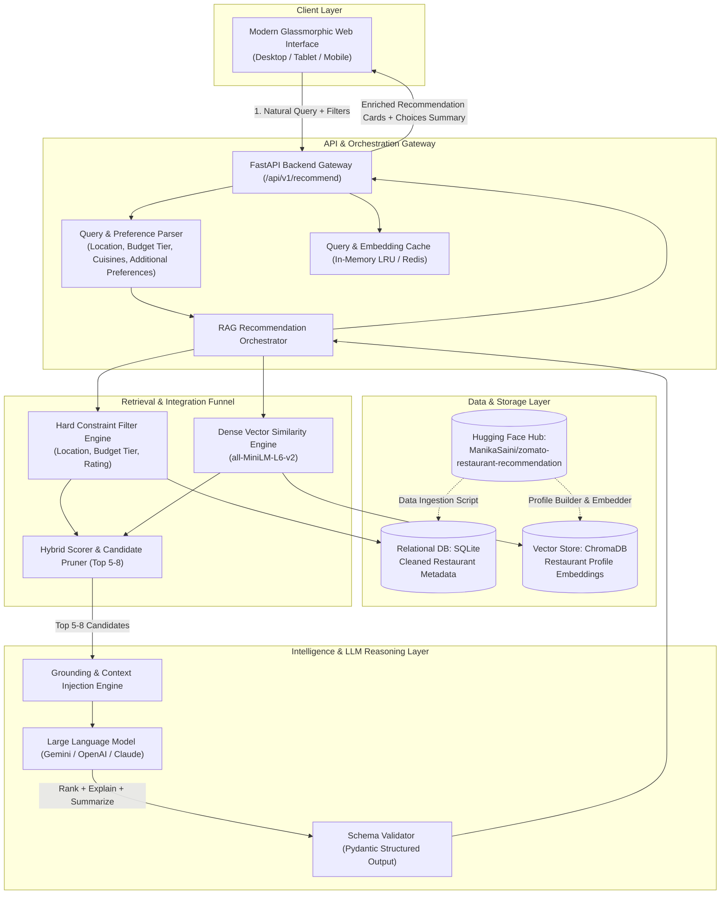
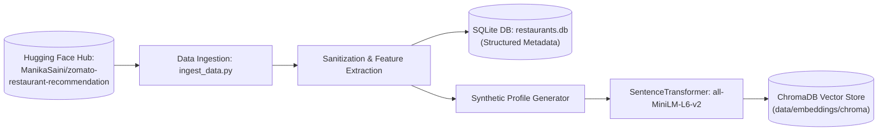
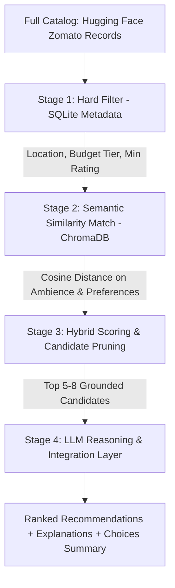
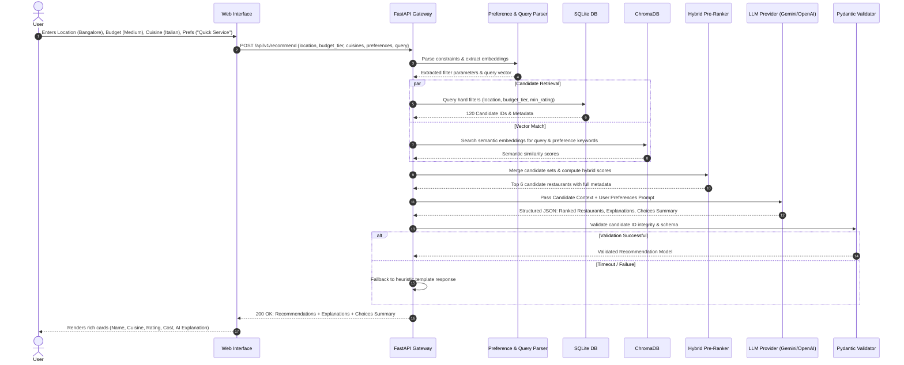

# System Architecture: AI-Powered Restaurant Recommendation System

## 1. Executive Summary & Architectural Goals
The **AI-Powered Restaurant Recommendation System** is designed to deliver personalized dining recommendations inspired by Zomato. The architecture merges deterministic tabular filtering with semantic search and Large Language Model (LLM) reasoning over the real-world **Hugging Face Zomato Restaurant Dataset** ([ManikaSaini/zomato-restaurant-recommendation](https://huggingface.co/datasets/ManikaSaini/zomato-restaurant-recommendation)).

### Core Architectural Principles
- **Hybrid Retrieval (RAG for Structured Data)**: Combines deterministic SQL-like filtering on hard constraints (location, budget tiers, minimum rating) with dense vector search on unstructured attributes (ambience, culinary vibes, review sentiments, additional preferences).
- **Strict Grounding & Hallucination Mitigation**: Enforces bounded context where the LLM can only select, rank, and explain verified restaurants retrieved from the underlying Hugging Face dataset.
- **Latency & Cost Efficiency**: Employs a multi-stage funnel (deterministic filter $\rightarrow$ vector search $\rightarrow$ heuristic pre-ranking $\rightarrow$ top-k LLM reasoning) to minimize token consumption and maintain sub-2.5s response latency.
- **Structured Explanations & Summarization**: Directs the LLM to provide per-restaurant justifications ("why this recommendation fits") and an overall high-level summary of choices.
- **Resilient Fallbacks**: Graceful degradation to deterministic template-ranked recommendations in the event of LLM provider timeouts or API rate limits.

---

## 2. High-Level System Architecture & Workflow



---

## 3. Subsystem Breakdown

### 3.1. Client & Presentation Layer (Frontend)
- **User Preference Inputs**:
  - **Location Selector / Input**: Prominent support for key cities and localities (e.g., *Delhi*, *Bangalore*, *Indiranagar*, *Connaught Place*).
  - **Budget Selector**:
    - **Categorical Tiers**: `low` ($\le ₹500$), `medium` ($₹500 - ₹1500$), `high` ($> ₹1500$).
    - **Custom Slider**: Dynamic numerical budget for two.
  - **Cuisine Multi-Select**: Chips and dropdowns for cuisines (e.g., *Italian*, *Chinese*, *North Indian*, *Cafe*, *Continental*).
  - **Minimum Rating Filter**: Interactive star rating selector ($\ge 3.0, 3.5, 4.0, 4.5$).
  - **Additional Preferences Chips**: Pre-curated quick chips for behavioral and qualitative traits (e.g., *Family-Friendly*, *Quick Service*, *Romantic Ambience*, *Outdoor Seating*, *Late Night*).
  - **Natural Language Query Bar**: Captures open-ended nuances (e.g., *"Quick Italian bite with authentic wood-fired pizza under medium budget in Bangalore"*).
- **Output Presentation Subsystem**:
  - **Overall Choices Summary**: Executive overview box generated by the LLM contrasting the selected top picks.
  - **Rich Restaurant Cards**:
    - **Restaurant Name**
    - **Cuisine Tags**
    - **Rating** (Star badge + vote volume)
    - **Estimated Cost** (Approximate cost for two)
    - **Location / Locality**
    - **AI-Generated Explanation Box**: Dedicated *"Why This Fits You"* section highlighting the tailored rationale.

### 3.2. API & Orchestration Layer (Backend)
- **Framework**: Python FastAPI (asynchronous, high performance, native Pydantic validation).
- **Core Endpoints**:
  - `POST /api/v1/recommend`: Main recommendation pipeline accepting user preferences and query.
  - `GET /api/v1/restaurants/{id}`: Full restaurant metadata, dishes liked, and customer reviews.
  - `GET /api/v1/cuisines`: List of distinct standardized cuisines for autocompletion.
  - `GET /api/v1/locations`: List of supported cities and neighborhoods (Delhi, Bangalore, etc.).
  - `POST /api/v1/feedback`: Telemetry on recommendation engagement.
- **Preference Ingestion & Normalization**:
  - Maps budget tiers (`low`, `medium`, `high`) to concrete upper/lower bounds in SQL queries.
  - Normalizes location inputs to dataset localities.

### 3.3. Data Ingestion & Storage Layer



#### Raw Dataset Attribute Mapping:
The Hugging Face dataset contains the following key columns which map to the application data model:

| Hugging Face Dataset Column | Target SQLite Column | Transformation & Sanitization Logic |
| :--- | :--- | :--- |
| `name` | `name` (TEXT) | Stripped of whitespace and special character noise. |
| `location`, `address` | `location`, `address`, `city` (TEXT) | Standardized location and inferred canonical city (e.g., Bangalore, Delhi). |
| `cuisines` | `cuisines` (TEXT / JSON) | Comma-separated strings split into canonical JSON arrays. |
| `approx_cost(for two people)` | `average_cost_for_two` (INTEGER) | Commas stripped (e.g., `"1,200"` $\rightarrow$ `1200`). Imputed if missing. |
| `rate` | `aggregate_rating` (REAL) | Parsed from `"4.1/5"`, `"NEW"`, `"-"` $\rightarrow$ float `4.1` or `0.0`. |
| `votes` | `votes` (INTEGER) | Integer cast with 0 floor. |
| `online_order` | `has_online_delivery` (BOOLEAN) | `"Yes"` $\rightarrow$ `True`, `"No"` $\rightarrow$ `False`. |
| `book_table` | `has_table_booking` (BOOLEAN) | `"Yes"` $\rightarrow$ `True`, `"No"` $\rightarrow$ `False`. |
| `rest_type`, `dish_liked` | `highlights` (TEXT / JSON) | Combined into searchable tags (e.g., `["Casual Dining", "Pasta", "Waffles"]`). |
| `reviews_list` | `reviews_summary` (TEXT) | Filtered and condensed into synthetic embedding profile document. |
| Computed | `budget_tier` (TEXT) | Derived: `low` ($\le 500$), `medium` ($501 - 1500$), `high` ($> 1500$). |

---

### 3.4. Multi-Stage Integration & Recommendation Funnel

To ensure sub-second retrieval and avoid saturating LLM context windows, the recommendation engine follows a 4-stage funnel:



1. **Stage 1 (Deterministic Filtering)**:
   - Evaluates hard constraints: `city / location`, `budget_tier` / `average_cost_for_two <= max_budget`, `aggregate_rating >= min_rating`.
2. **Stage 2 (Semantic Vector Retrieval)**:
   - Computes cosine similarity between user query embedding (plus additional preferences like "family-friendly", "quick service") and candidate restaurant profile embeddings.
3. **Stage 3 (Hybrid Heuristic Scoring)**:
   - Unified candidate ranking score:
     $$\text{FinalScore} = 0.5 \cdot S_{\text{semantic}} + 0.3 \cdot \left(\frac{\text{Rating}}{5.0}\right) + 0.2 \cdot \left(\frac{\log(1 + \text{Votes})}{\log(1 + \text{Votes}_{\max})}\right)$$
   - Prunes candidates down to top $K$ (5 to 8) highest-scoring venues.
4. **Stage 4 (LLM Reasoning & Synthesis)**:
   - The LLM evaluates the pruned candidates, ranks the final top 3–5 items, generates custom explanations for why each recommendation fits, and provides a choices summary.

---

### 3.5. LLM Prompt Design & Integration Layer

- **System Instruction**:
  - Persona: Expert AI Dining Concierge.
  - Strict grounding directive: *"You are given a bounded candidate list from the Zomato dataset. You must ONLY recommend and rank restaurants from this candidate list. You must NEVER fabricate restaurants, dishes, or prices."*
- **Context Injection**:
  - Top 5 candidate restaurants encoded as compact JSON objects with `restaurant_id`, `name`, `cuisine`, `estimated_cost`, `rating`, `location`, `highlights`.
- **User Intent Block**:
  - Location, budget tier, cuisine, minimum rating, additional preferences (e.g., "family-friendly", "quick service"), and raw query.
- **Output Requirements**:
  - Order/Rank the candidates.
  - Produce an executive `choices_summary` contrasting the selections.
  - Produce an `ai_explanation` for each restaurant with `summary`, `why_recommended`, and `highlighted_features`.
- **Validation & Fallback**:
  - Pydantic validates candidate ID integrity. If the LLM provider times out (>3.0s) or fails, the orchestrator defaults to a deterministic template using the hybrid pre-ranker.

---

## 4. End-to-End Sequence Diagram



---

## 5. Data Contracts & API Specifications

### 5.1. Recommendation Request DTO (`POST /api/v1/recommend`)
```json
{
  "query": "Authentic wood-fired pizza with quick turnaround",
  "location": "Bangalore",
  "budget_tier": "medium",
  "max_cost_for_two": 1500,
  "min_rating": 4.0,
  "cuisines": ["Italian", "Pizza"],
  "additional_preferences": ["quick service", "family-friendly"],
  "top_k": 3
}
```

### 5.2. Recommendation Response DTO
```json
{
  "status": "success",
  "choices_summary": "Here are 3 top-rated Italian restaurants in Bangalore fitting your medium budget with quick service: Chianti stands out for rapid artisan pasta and ambient seating, while Tossin Pizza offers the quickest wood-fired pizza turnaround.",
  "query_summary": {
    "location": "Bangalore",
    "budget_tier": "medium",
    "cuisines": ["Italian", "Pizza"],
    "additional_preferences": ["quick service", "family-friendly"],
    "total_candidates_analyzed": 54
  },
  "recommendations": [
    {
      "restaurant_id": 1042,
      "name": "Chianti Italian Restaurant & Wine Lounge",
      "cuisine": "Italian, Pizza, Pasta",
      "rating": 4.5,
      "votes": 2840,
      "estimated_cost": 1200,
      "location": "Indiranagar, Bangalore",
      "address": "12th Main Rd, HAL 2nd Stage, Indiranagar",
      "match_score": 0.94,
      "ai_explanation": {
        "summary": "Fits your medium budget with reliable quick service.",
        "why_recommended": "Chianti offers exceptional wood-fired pizzas and an efficient kitchen service that accommodates quick dining without sacrificing authentic quality, comfortably within your medium budget.",
        "highlighted_features": ["Quick Kitchen Turnaround", "Wood-Fired Pizza", "Medium Budget Fit"]
      }
    }
  ]
}
```

---

## 6. Directory & Codebase Structure

```text
antigravity/
├── Docs/
│   ├── problem_statement.txt       # User problem statement & workflow
│   ├── problemStatement.md        # Comprehensive problem statement
│   ├── architecture.md            # Detailed system architecture (this file)
│   ├── implementation-plan.md     # Phase-wise roadmap
│   └── edge-case.md               # Boundary scenarios & mitigation matrix
├── edge-case.md                   # Root pointer to Docs/edge-case.md
├── data/
│   ├── raw/                       # Cached Hugging Face raw dataset
│   ├── processed/
│   │   └── restaurants.db         # SQLite metadata database
│   └── embeddings/
│       └── chroma/                # ChromaDB vector collection
├── backend/
│   ├── app/
│   │   ├── main.py                # FastAPI entry point & routes
│   │   ├── config.py              # Configuration & API keys (Pydantic Settings)
│   │   ├── core/
│   │   │   ├── orchestrator.py    # Master RAG pipeline coordinator
│   │   │   └── scorer.py          # Hybrid ranking algorithm
│   │   ├── models/
│   │   │   ├── schemas.py         # Request / Response Pydantic DTOs
│   │   │   └── database.py        # SQLAlchemy SQLite models
│   │   ├── services/
│   │   │   ├── llm_service.py     # LLM reasoning, ranking & summary prompts
│   │   │   ├── vector_service.py  # ChromaDB semantic search operations
│   │   │   └── data_service.py    # SQLite filtering & budget tier logic
│   │   └── scripts/
│   │       ├── ingest_data.py     # Hugging Face dataset download & cleaning
│   │       └── build_index.py     # Profile embedding generator
│   ├── requirements.txt
│   └── tests/
├── frontend/
│   ├── index.html                 # Accessible layout & filter controls
│   ├── css/
│   │   └── style.css              # Glassmorphic dark design system
│   ├── js/
│   │   ├── app.js                 # State management & API integration
│   │   └── components.js          # Card rendering & summary presentation
│   └── assets/                    # Placeholder graphics & cuisine icons
└── README.md
```

---

## 7. Performance, Reliability & Guardrails

### 7.1. Latency Optimization
- **Embedding Cache**: Cache query representations using an in-memory LRU cache so recurring queries skip vector generation.
- **Pre-Filtering in SQLite**: Pre-filter candidate IDs via SQLite query before vector re-ranking to constrain ChromaDB computation to relevant sub-regions.
- **Asynchronous Execution**: Run SQLite metadata fetch and ChromaDB vector search concurrently via `asyncio`.

### 7.2. Anti-Hallucination Guardrails
- **Prompt Sandboxing**: Enforce that the LLM is restricted exclusively to provided candidates.
- **Candidate ID Verification**: Pydantic validator asserts all returned IDs exist in the retrieved pool.
- **Fail-Safe Fallback**: If the LLM provider fails or times out (>3.0s), return top candidates from the pre-ranker with template-generated explanations.
