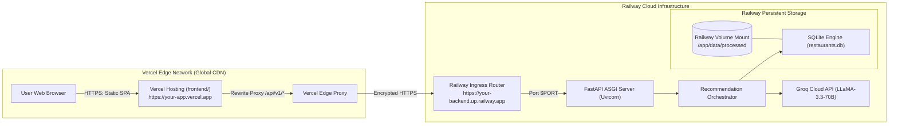

# Deployment Plan: Vercel (Frontend) & Railway (Backend)

This document provides the definitive, step-by-step production deployment guide for hosting the **Frontend on Vercel** and the **FastAPI Backend on Railway**, including persistent SQLite storage, environment configuration, zero-CORS proxying, and pre-flight validation.

---

## 1. Architecture Overview



---

## 2. Component Deployment Breakdown

| Layer | Hosting Provider | Directory / Runtime | Key Configuration |
| :--- | :--- | :--- | :--- |
| **Frontend** | **Vercel** | `frontend/` (Static SPA) | Root directory: `frontend`, zero-config or `vercel.json` rewrite |
| **Backend API** | **Railway** | Root / Python 3.11+ (Uvicorn) | Nixpacks / Dockerfile, dynamic `$PORT`, startup seeder |
| **Relational DB** | **Railway** | SQLite (`restaurants.db`) | Railway Persistent Volume mounted to `/app/data/processed` |
| **AI / LLM** | **Groq Cloud** | External API | `GROQ_API_KEY` with automatic heuristic fallback |

---

## 3. Phase 1: Deploying Backend on Railway

Railway will run your FastAPI application, provide automated HTTPS on a `*.up.railway.app` domain, and provide persistent disk storage for your SQLite database.

### Step 1.1: Prepare Railway Configuration Files

Railway automatically detects Python via `requirements.txt`. To guarantee startup and database persistence, ensure these files exist:

1. **`Procfile` (in project root)**:
   ```procfile
   web: python -m backend.app.scripts.ingest_data && uvicorn backend.app.main:app --host 0.0.0.0 --port $PORT --workers 2
   ```
   > **Note**: Running `ingest_data.py` on startup ensures `restaurants.db` is initialized and populated if it is the first deploy or after volume mounting.

2. **`requirements.txt` (in project root)**:
   Already generated. Ensure core packages are locked:
   ```text
   fastapi>=0.110.0
   uvicorn>=0.28.0
   sqlalchemy>=2.0.0
   pydantic>=2.6.0
   pydantic-settings>=2.0.0
   python-dotenv>=1.0.0
   httpx>=0.27.0
   ```

### Step 1.2: Create Project and Connect GitHub to Railway

1. Go to [railway.app](https://railway.app) and sign in with GitHub.
2. Click **"New Project"** &rarr; Select **"Deploy from GitHub repo"**.
3. Select your repository: `antigravity`.
4. Railway will create a new service and begin analyzing the repository.

### Step 1.3: Attach a Persistent Volume (Critical for SQLite)

By default, containers on cloud platforms have ephemeral disks that reset on redeployments. To keep `restaurants.db` permanent:

1. Open your service card in the Railway dashboard.
2. Click on the **"Volumes"** tab (or right-click canvas &rarr; **"Add Volume"**).
3. Connect the volume to your backend service.
4. Set the **Mount Path** to:
   ```text
   /app/data/processed
   ```
5. Click **"Save"**.

### Step 1.4: Configure Railway Environment Variables

In your Railway service, go to **"Variables"** &rarr; **"Add Variable"** and set:

| Variable | Value | Description |
| :--- | :--- | :--- |
| `LLM_PROVIDER` | `groq` | Enables Groq LLM inference |
| `GROQ_API_KEY` | `gsk_...` | Your production Groq API key |
| `GROQ_MODEL` | `llama-3.3-70b-versatile` | Ultra-fast LPU model |
| `DEBUG` | `false` | Disables debug mode in production |
| `CORS_ORIGINS` | `["*"]` | Allows web calls (or restrict to your Vercel URL once known) |

> **Note on `PORT`**: Railway automatically injects the `$PORT` environment variable. Do not hardcode port 8000. Uvicorn in the `Procfile` binds to `$PORT`.

### Step 1.5: Generate Railway Domain & Test

1. In your service settings under **"Networking"** &rarr; Click **"Generate Domain"**.
2. Railway will issue a public URL such as:
   ```text
   https://antigravity-production.up.railway.app
   ```
3. Test your live backend endpoints in your browser or curl:
   - `https://your-backend.up.railway.app/docs` &rarr; (200 OK Swagger UI)
   - `https://your-backend.up.railway.app/api/v1/locations` &rarr; (200 OK JSON list of cities/neighborhoods)

---

## 4. Phase 2: Deploying Frontend on Vercel

Vercel provides edge CDN delivery, instant previews, and automated SSL for static applications.

### Step 2.1: Add `vercel.json` (Zero-CORS URL Rewrite Proxy)

Create `frontend/vercel.json` with the following content:

```json
{
  "version": 2,
  "rewrites": [
    {
      "source": "/api/v1/:path*",
      "destination": "https://YOUR-RAILWAY-APP.up.railway.app/api/v1/:path*"
    }
  ]
}
```

> **Why this is the best approach**:
> - **Zero CORS issues**: The browser makes requests to `/api/v1/...` on your same Vercel domain, which Vercel's edge securely proxies to Railway.
> - **Clean codebase**: No hardcoded production URLs inside your JavaScript files.

### Step 2.2: Ensure Dynamic API Base in `frontend/js/app.js`

In [`frontend/js/app.js`](file:///f:/AI%20projects/antigravity/frontend/js/app.js), the API path is already configured to automatically use `/api/v1`:

```javascript
// Automatically use /api/v1 in production (proxied by Vercel), or localhost:8000 during local dev
const API_BASE = (window.location.hostname === "localhost" || window.location.hostname === "127.0.0.1")
  ? "http://localhost:8000/api/v1"
  : "/api/v1";
```

### Step 2.3: Import Repository to Vercel

1. Log in to [vercel.com](https://vercel.com) with GitHub.
2. Click **"Add New..."** &rarr; **"Project"**.
3. Select your GitHub repository (`antigravity`).
4. Configure Project Settings:
   - **Framework Preset**: `Other`
   - **Root Directory**: Click **Edit** &rarr; Select `frontend` &rarr; Click **Continue**.
   - **Build Command**: Leave empty (static site).
   - **Output Directory**: Leave empty (`.` current directory).
5. Click **"Deploy"**.

Within 20–30 seconds, Vercel will deploy your site and provide a production domain:
```text
https://antigravity-frontend.vercel.app
```

---

## 5. Phase 3: Final Integration & CORS Verification

Once both services are active:

1. **If using `vercel.json` rewrite**:
   Replace `YOUR-RAILWAY-APP.up.railway.app` in `frontend/vercel.json` with your real Railway domain, commit, and push to GitHub. Vercel will redeploy automatically.
2. **Update Railway CORS (Security Best Practice)**:
   Once your Vercel domain is known, update the `CORS_ORIGINS` variable in Railway:
   ```json
   ["https://antigravity-frontend.vercel.app", "http://localhost:3000"]
   ```

---

## 6. Pre-Flight Verification Checklist

Run through this checklist before sharing the application:

- [ ] **Railway Backend Live**:
  - Visit `https://<railway-url>/docs` &rarr; Status 200 OK.
  - Visit `https://<railway-url>/api/v1/locations` &rarr; Returns array of cities/neighborhoods.
  - Visit `https://<railway-url>/api/v1/cuisines` &rarr; Returns array of cuisines.
- [ ] **Railway Volume Mounted**:
  - Verify volume is attached to `/app/data/processed` so `restaurants.db` is never deleted on redeploys.
- [ ] **Vercel Frontend Live**:
  - Visit `https://<vercel-url>` &rarr; Nocturne Gourmet UI loads with dark theme and atmospheric glow.
  - Test searching: Click **"✨ Generate Recommendations"** &rarr; Confirms cards and AI summary load.
  - Test prompt chips: Click *"Best wood-fired pizza in Indiranagar"* &rarr; Cards update dynamically.
- [ ] **Console Inspection**:
  - Open Browser DevTools (`F12` &rarr; Console/Network tab).
  - Verify network requests to `/api/v1/recommend` complete with HTTP 200 and no mixed-content or CORS errors.

---

## 7. Troubleshooting Common Issues

### Issue A: "502 Bad Gateway" on Railway
- **Cause**: Uvicorn is bound to port 8000 instead of `$PORT`.
- **Fix**: Verify your `Procfile` contains `--port $PORT`.

### Issue B: "Empty Recommendations / 0 candidates"
- **Cause**: Database was not seeded on Railway.
- **Fix**: Check that the start command runs `python -m backend.app.scripts.ingest_data` before Uvicorn. You can also run it via Railway CLI (`railway run python -m backend.app.scripts.ingest_data`).

### Issue C: CORS Blocked when calling Railway directly
- **Cause**: `CORS_ORIGINS` on Railway does not include your Vercel URL.
- **Fix**: Either use the `frontend/vercel.json` rewrite proxy (recommended, eliminates CORS), or add `"https://<your-vercel-domain>.vercel.app"` to `CORS_ORIGINS` in Railway environment variables.
