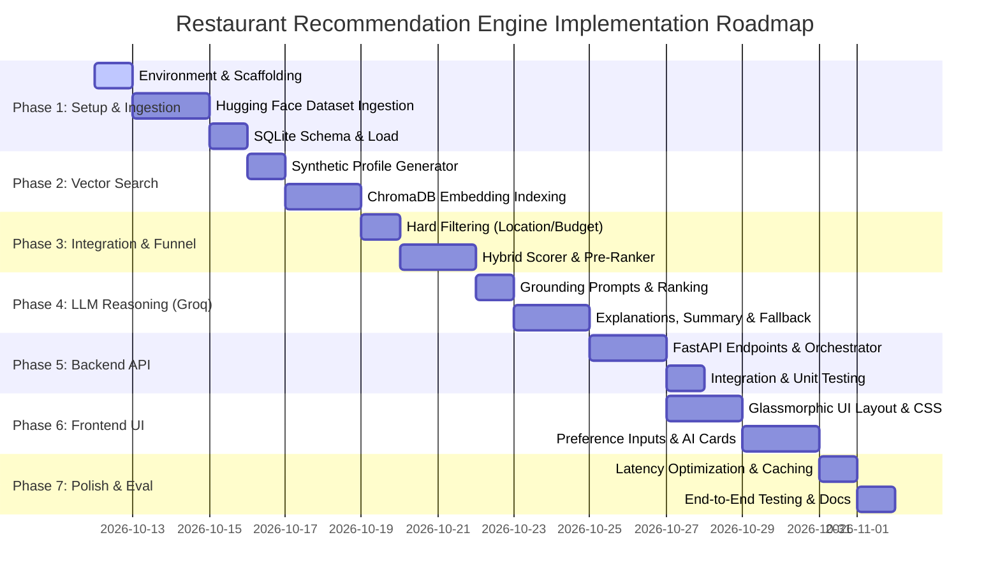

# Phase-Wise Implementation Plan: AI-Powered Restaurant Recommendation System

## 1. Project Roadmap Overview

This implementation plan provides a structured, phase-by-phase blueprint for building the **AI-Powered Restaurant Recommendation System** outlined in [problemStatement.md](file:///f:/AI%20projects/antigravity/Docs/problemStatement.md) and [architecture.md](file:///f:/AI%20projects/antigravity/Docs/architecture.md), ingesting the Hugging Face Zomato dataset ([ManikaSaini/zomato-restaurant-recommendation](https://huggingface.co/datasets/ManikaSaini/zomato-restaurant-recommendation)).



---

## Phase 1: Environment Scaffolding & Hugging Face Data Ingestion

### Objective
Establish the repository structure, configure dependencies including Hugging Face `datasets`, and clean and ingest the Zomato restaurant dataset from `ManikaSaini/zomato-restaurant-recommendation` into structured SQLite storage.

### Deliverables
- Working directory scaffold matching [architecture.md](file:///f:/AI%20projects/antigravity/Docs/architecture.md#6-directory--codebase-structure).
- Python virtual environment with defined `backend/requirements.txt`.
- Data acquisition and cleaning script (`ingest_data.py`) populating `data/processed/restaurants.db` (SQLite).

### Tasks
- [ ] **Task 1.1**: Initialize folder hierarchy:
  ```text
  data/raw/, data/processed/, data/embeddings/
  backend/app/{core, models, services, scripts}
  frontend/{css, js, assets}
  ```
- [ ] **Task 1.2**: Create `backend/requirements.txt`:
  - `fastapi`, `uvicorn[standard]`, `pydantic`, `pydantic-settings`
  - `datasets`, `huggingface-hub`, `pandas`, `numpy`, `sqlalchemy`, `aiosqlite`
  - `chromadb`, `sentence-transformers`
  - `groq`, `httpx` (with optional `google-genai` / `openai`)
  - `python-dotenv`, `pytest`
- [ ] **Task 1.3**: Implement configuration management in `backend/app/config.py` loading API keys (`GROQ_API_KEY`), dataset source identifier (`ManikaSaini/zomato-restaurant-recommendation`), and scoring weights via Pydantic `BaseSettings`.
- [ ] **Task 1.4**: Implement dataset downloader and cache in `backend/app/scripts/ingest_data.py`:
  - Load dataset directly from Hugging Face: `datasets.load_dataset("ManikaSaini/zomato-restaurant-recommendation")` with fallback to direct CSV download if offline.
- [ ] **Task 1.5**: Build data sanitization pipeline in `ingest_data.py`:
  - Map Hugging Face fields: `name`, `location`/`address`, `cuisines`, `approx_cost(for two people)`, `rate`, `votes`, `rest_type`, `dish_liked`, `reviews_list`.
  - Parse `rate` strings (`"4.1/5"`, `"NEW"`, `"-"`) into clean float `aggregate_rating` (0.0 to 5.0).
  - Clean `approx_cost(for two people)` by stripping commas (`"1,200"` $\rightarrow$ `1200`) into `average_cost_for_two`.
  - Classify each restaurant into a canonical `budget_tier`: `low` ($\le ₹500$), `medium` ($₹501 - ₹1500$), `high` ($> ₹1500$).
  - Standardize cuisine strings into JSON arrays.
  - Synthesize `highlights` from `rest_type` and `dish_liked`.
- [ ] **Task 1.6**: Define SQLAlchemy ORM schema in `backend/app/models/database.py` and commit sanitized records into `data/processed/restaurants.db` (SQLite).

### Acceptance Criteria
- Running `python backend/app/scripts/ingest_data.py` completes with progress output.
- SQLite query `SELECT COUNT(*) FROM restaurants;` returns clean sanitized records.
- Zero NaN values in critical filter columns (`average_cost_for_two`, `location`, `aggregate_rating`, `budget_tier`).

---

## Phase 2: Vector Store & Profile Indexing

### Objective
Create rich synthetic text profiles for each restaurant capturing cuisines, location, budget tier, dishes liked, and customer sentiments, and build a persistent ChromaDB vector index.

### Deliverables
- Profile generation utility in `backend/app/scripts/build_index.py`.
- Persisted vector database index in `data/embeddings/chroma/`.

### Tasks
- [ ] **Task 2.1**: Implement a textual profile generator that incorporates key restaurant attributes:
  ```python
  def generate_restaurant_profile(row) -> str:
      return (
          f"{row['name']} is a {row['cuisines']} dining place located in {row['location']}. "
          f"Budget tier: {row['budget_tier']} (average cost for two: ₹{row['average_cost_for_two']}). "
          f"Rating: {row['aggregate_rating']} stars with {row['votes']} reviews. "
          f"Popular features: {row['highlights']}. "
          f"Atmosphere & highlights: {row['reviews_summary'][:200]}."
      )
  ```
- [ ] **Task 2.2**: Integrate embedding generation using `all-MiniLM-L6-v2` (384-dimensional dense vectors).
- [ ] **Task 2.3**: Batch process restaurants and insert vectors and metadata (`location`, `budget_tier`, `rating`, `primary_cuisine`) into ChromaDB at `data/embeddings/chroma/`.
- [ ] **Task 2.4**: Implement `backend/app/services/vector_service.py` to wrap vector search queries with cosine distance scoring and metadata filtering.

### Acceptance Criteria
- Running `python backend/app/scripts/build_index.py` indexes all valid records without memory leaks.
- Vector query test: Searching *"quick service pasta with outdoor seating"* returns matching candidates within $< 50\text{ms}$.

---

## Phase 3: Integration Layer & Hybrid Candidate Funnel

### Objective
Develop the integration layer combining SQL deterministic filtering (location, budget tier, minimum rating) with dense semantic vector scoring to extract and pre-rank the top-$K$ candidates for LLM reasoning.

### Deliverables
- `backend/app/services/data_service.py` (Structured SQL queries with budget tier & location filtering).
- `backend/app/core/scorer.py` (Hybrid scoring algorithm balancing semantic similarity, rating, and vote volume).
- Unit tests verifying multi-stage funnel execution.

### Tasks
- [ ] **Task 3.1**: Implement deterministic filtering in `data_service.py`:
  - Supports: `location` (e.g., Delhi, Bangalore, specific neighborhoods), `budget_tier` (`low`, `medium`, `high`) or numerical ceiling `max_cost_for_two`, `min_rating`, and cuisine filtering.
- [ ] **Task 3.2**: Implement hybrid pre-ranker in `scorer.py`:
  - Calculate normalized score combining semantic similarity, rating, and log-scaled popularity:
    $$S_{\text{final}} = 0.5 \cdot S_{\text{semantic}} + 0.3 \cdot \left(\frac{\text{Rating}}{5.0}\right) + 0.2 \cdot \left(\frac{\log(1 + \text{Votes})}{\log(1 + \text{Votes}_{\max})}\right)$$
- [ ] **Task 3.3**: Combine results via candidate pruner:
  - If filters yield $< 3$ results, activate the **Constraint Relaxation Ladder** (broaden rating by 0.5, expand budget tier, expand locality) and flag response with user notification.
- [ ] **Task 3.4**: Write unit tests in `backend/tests/test_retrieval.py` testing budget tier bounds, cuisine matching, and zero-match edge cases.

### Acceptance Criteria
- Unit tests pass with 100% adherence to strict constraints (no restaurants exceeding budget tier ceiling).
- Retrieval and pre-ranking execution time $< 150\text{ms}$ for candidate pools of 10,000+ items.

---

## Phase 4: LLM Reasoning, Ranking, Explanations & Summarization (Powered by Groq)

### Objective
Integrate the LLM reasoning pipeline powered by **Groq's ultra-low latency LPU™ inference engine** (using models such as `llama-3.3-70b-versatile` or `llama-3.1-8b-instant`) to rank top candidate restaurants, generate persuasive personalized explanations explaining *why* each recommendation fits user preferences, synthesize an executive choices summary, and guarantee zero-downtime deterministic fallbacks.

### Deliverables
- `backend/app/services/llm_service.py` with Groq API integration and structured JSON Mode enforcement.
- Grounded prompt templates tailored for Groq models with strict anti-hallucination constraints.
- Pydantic validation pipeline enforcing candidate ID integrity and schema adherence.
- Deterministic heuristic fallback generator (`generate_heuristic_fallback`) for rate-limits, timeouts, or network failures.
- Environment and configuration updates in `backend/app/config.py` supporting `GROQ_API_KEY`, `GROQ_MODEL`, and `LLM_PROVIDER="groq"`.

### Tasks
- [ ] **Task 4.1**: Implement Groq LLM client interface in `backend/app/services/llm_service.py`:
  - Support official Groq SDK (`groq.AsyncGroq`) and async HTTP client (`httpx.AsyncClient`) calling `https://api.groq.com/openai/v1/chat/completions`.
  - Load `GROQ_API_KEY` and `GROQ_MODEL` (default: `llama-3.3-70b-versatile` / `llama-3.1-8b-instant`) from `backend/app/config.py`.
  - Implement non-blocking asynchronous execution with a configurable timeout ceiling (`LLM_TIMEOUT_SECONDS=3.0`).
- [ ] **Task 4.2**: Design grounded prompt engineering templates for Groq:
  - **System Prompt**: Impartial culinary recommendation expert with strict grounding guardrails:
    *"You may ONLY select and rank from the provided candidate list. Never invent restaurants, prices, or dishes. Output strictly valid JSON."*
  - **Context Serialization**: Compact JSON representation of top candidate pool ($K \le 5$) containing `id`, `name`, `cuisines`, `average_cost_for_two`, `aggregate_rating`, `votes`, `location`, `highlights`, and `reviews_summary`.
  - **Reasoning Directives**:
    1. **Rank Candidates**: Re-rank the top 3–5 recommendations best matching explicit criteria (budget tier, cuisine, location) and implicit preferences (e.g., romantic, family-friendly, quick service).
    2. **Generate Rationales**: For each venue, generate personalized `ai_explanation` containing `summary`, `why_recommended` (citing specific user criteria), and `highlighted_features`.
    3. **Executive Summary**: Synthesize an overarching `choices_summary` comparing recommendations and highlighting trade-offs (e.g., best budget vs. highest rated).
- [ ] **Task 4.3**: Enforce structured JSON output via Groq JSON Mode:
  - Configure request payload with `response_format={"type": "json_object"}` and deterministic low temperature ($\tau = 0.2$).
  - Enforce response parsing into Pydantic models: `RecommendationResponse`, `RecommendationItem`, and `AIExplanation`.
- [ ] **Task 4.4**: Candidate ID integrity & anti-hallucination validation:
  - Validate returned `restaurant_id` values against the retrieved candidate set: $\text{ID}_{\text{returned}} \in \{\text{ID}_{\text{candidate}}\}$.
  - Discard or remap ungrounded or hallucinated candidate IDs before passing data to the orchestrator.
- [ ] **Task 4.5**: Resilient deterministic fallback engine:
  - Gracefully catch Groq API rate limits (HTTP 429), timeouts ($> 3\text{s}$), connection interruptions, or malformed JSON.
  - Implement `generate_heuristic_fallback()` to immediately construct template explanations and an executive summary from SQLite metadata when Groq is unreachable.
  - Ensure fallback responds in $< 15\text{ms}$ with zero unhandled exceptions.
- [ ] **Task 4.6**: Latency and token throughput optimization:
  - Cap `max_tokens` (1000–1500) to leverage Groq LPU's sub-second generation speeds.
  - Add structured logging for token consumption, Groq round-trip latency (ms), and fallback trigger events.

### Acceptance Criteria
- Groq API requests successfully return validated JSON conforming to the Pydantic schema in $< 1.5\text{s}$.
- Output recommendations reference only genuine candidates from the database (zero hallucinated restaurant names or IDs).
- Missing `GROQ_API_KEY` or forced network timeout smoothly activates deterministic heuristic fallback with 0 runtime errors.
- Every successful response contains both individual "why it fits" rationales and a cohesive executive `choices_summary`.

---

## Phase 5: FastAPI Backend Development & Orchestration

### Objective
Build the RESTful API server coordinating user preference ingestion, candidate filtering, LLM reasoning, and response delivery.

### Deliverables
- Working FastAPI application (`backend/app/main.py`) with Swagger documentation at `/docs`.
- Orchestrator module (`backend/app/core/orchestrator.py`) linking all components.

### Tasks
- [x] **Task 5.1**: Define API request/response DTOs in `backend/app/models/schemas.py`:
  - `RecommendationRequest`: `location`, `budget_tier`, `max_cost_for_two`, `min_rating`, `cuisines`, `additional_preferences`, `query`, `top_k`.
  - `RecommendationResponse`: `status`, `choices_summary`, `query_summary`, `recommendations` list.
- [x] **Task 5.2**: Implement `backend/app/core/orchestrator.py`:
  - Coordinate: Preference Parsing $\rightarrow$ Parallel DB/Vector Search $\rightarrow$ Pre-Ranking $\rightarrow$ LLM Reasoning & Summarization $\rightarrow$ Response Formatting.
- [x] **Task 5.3**: Implement FastAPI routes:
  - `POST /api/v1/recommend`: Main recommendation flow.
  - `GET /api/v1/restaurants/{id}`: Detailed restaurant view.
  - `GET /api/v1/cuisines`: Distinct standardized cuisines.
  - `GET /api/v1/locations`: Distinct locations and cities (Delhi, Bangalore, etc.).
  - `POST /api/v1/feedback`: Log recommendation engagement.
- [x] **Task 5.4**: Add CORS middleware, security headers, and uniform exception handlers.
- [x] **Task 5.5**: Write integration tests in `backend/tests/test_api.py`.

### Acceptance Criteria
- `uvicorn backend.app.main:app --reload` runs cleanly on `localhost:8000`.
- Calling `POST /api/v1/recommend` via curl returns structured recommendations and choices summary in $< 2.5$ seconds.

---

## Phase 6: Modern Interactive Frontend Development

### Objective
Create a responsive, glassmorphic web interface that allows users to express dining desires through structured preference controls and natural language, displaying recommendation cards with AI explanations.

### Deliverables
- `frontend/index.html` (Semantic, accessible layout).
- `frontend/css/style.css` (Glassmorphic dark aesthetic, micro-animations).
- `frontend/js/app.js` and `frontend/js/components.js` (UI logic, API client, card rendering).

### Tasks
- [ ] **Task 6.1**: Build semantic structure in `frontend/index.html`:
  - Hero header with brand title, tagline, and theme controls.
  - **Preference Controls**:
    - Location selector / autocomplete (Delhi, Bangalore, etc.).
    - Budget tier pills (`Low: <₹500`, `Medium: ₹500-1500`, `High: >₹1500`) + custom cost slider.
    - Cuisine multi-select chips (Italian, Chinese, North Indian, etc.).
    - Minimum rating star selector ($\ge 3.0, 3.5, 4.0, 4.5$).
    - Additional preferences pills (*Family-Friendly*, *Quick Service*, *Romantic*, *Outdoor*, *Late Night*).
    - Natural language search bar with voice/example prompts.
  - Results feed: Executive **Choices Summary** box followed by recommendation cards and shimmer skeleton loaders.
- [ ] **Task 6.2**: Design premium CSS in `frontend/css/style.css`:
  - Dark mode with warm coral/amber accents (`#FF7E67`, `#FFA07A`) on obsidian dark background (`#0D0F12`).
  - Google Fonts (`Outfit` or `Inter`).
  - Glassmorphic card styling (`backdrop-filter: blur(12px)`).
- [ ] **Task 6.3**: Build UI components in `frontend/js/components.js`:
  - `renderChoicesSummary(summary)`: Renders executive overview banner.
  - `renderRestaurantCard(restaurant)`: Card displaying:
    - **Restaurant Name**
    - **Cuisine Tags**
    - **Rating** (Star badge & votes)
    - **Estimated Cost** (approx. cost for two)
    - **Location / Neighborhood**
    - **"Why This Fits You"** AI explanation box.
- [ ] **Task 6.4**: Implement reactive state in `frontend/js/app.js`:
  - Handle inputs, active chip selections, form submissions, and error states.

### Acceptance Criteria
- UI loads with zero console errors.
- Submitting preferences displays loading skeleton, followed by smooth rendering of choices summary and restaurant cards.
- Fully responsive on mobile, tablet, and desktop viewports.

---

## Phase 7: Optimization, Evaluation & Deployment Readiness

### Objective
Optimize end-to-end response times, conduct edge-case stress testing, verify anti-hallucination guardrails, and prepare comprehensive runbooks.

### Deliverables
- Query caching mechanism.
- Performance and evaluation report.
- Complete `README.md` with setup, execution, and API documentation.

### Tasks
- [ ] **Task 7.1**: Implement caching for frequent queries and embedding generation (in-memory LRU or Redis).
- [ ] **Task 7.2**: Stress-test edge cases documented in [edge-case.md](file:///f:/AI%20projects/antigravity/Docs/edge-case.md):
  - Budget tier edge cases (`low`, `medium`, `high` boundaries).
  - Unrated / new restaurants from Hugging Face dataset.
  - Adversarial prompt injection attempts.
- [ ] **Task 7.3**: Measure key performance metrics:
  - End-to-end latency ($P_{50} < 1.5\text{s}$, $P_{95} < 2.5\text{s}$).
  - Retrieval recall across 20 synthetic benchmark queries.
- [ ] **Task 7.4**: Assemble root `README.md` with step-by-step setup and launch instructions.

### Acceptance Criteria
- All 7 phases completed and verified against criteria.
- Complete local run works out-of-the-box following `README.md` instructions.
