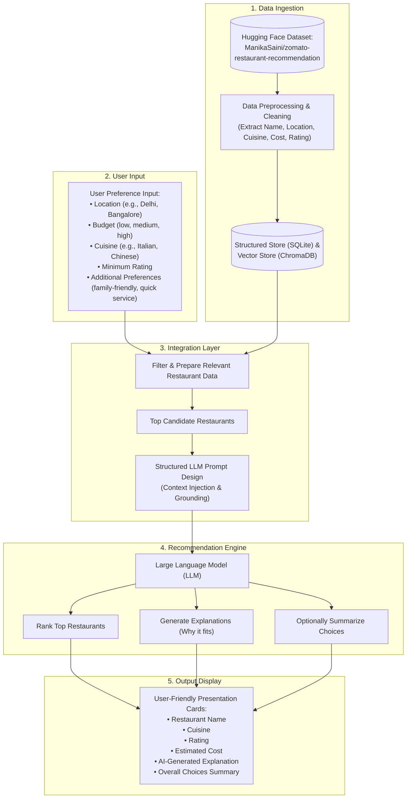

# Problem Statement: AI-Powered Restaurant Recommendation System (Zomato Use Case)

## 1. Project Overview & Context
Modern food discovery platforms like **Zomato** handle vast amounts of restaurant data, including cuisines, geographic locations, price tiers, customer reviews, and aggregated ratings. While traditional recommendation engines rely primarily on rigid keyword search or basic rule-based filters (e.g., *Cuisine = Italian* AND *Cost <= ₹500*), users often search with nuanced, context-dependent, and natural preferences (e.g., *"A cozy, quiet spot for an anniversary dinner with great pasta and quick service under a medium budget"*).

This project focuses on designing and implementing an **AI-powered restaurant recommendation engine** inspired by Zomato. The system bridges the gap between structured tabular data and flexible human intent by combining **deterministic data filtering** with the reasoning and synthesis capabilities of a **Large Language Model (LLM)**.

---

## 2. Core Objectives
Design and implement an application that:
1. **Captures Dynamic User Preferences**: Ingests multi-faceted user inputs—including location (e.g., Delhi, Bangalore), budget tier (`low`, `medium`, `high`) or numerical budget, cuisine (e.g., Italian, Chinese), minimum ratings, and additional qualitative preferences (e.g., family-friendly, quick service).
2. **Utilizes Real-World Dataset**: Ingests, normalizes, and preprocesses the real-world Zomato restaurant dataset from **Hugging Face**: [ManikaSaini/zomato-restaurant-recommendation](https://huggingface.co/datasets/ManikaSaini/zomato-restaurant-recommendation).
3. **Employs LLM-Powered Reasoning & Synthesis**: Leverages an LLM within an integration layer to rank retrieved candidate restaurants, generate tailored human-like justifications explaining *why* each place fits the request, and optionally summarize the overall set of choices.
4. **Delivers an Intuitive & Actionable Interface**: Displays clear, structured, and visually engaging results featuring key decision metrics: Restaurant Name, Cuisine, Rating, Estimated Cost, and AI-generated explanation.

---

## 3. End-to-End System Workflow

### Detailed Workflow Stages

#### 3.1. Data Ingestion
- **Source**: Load the Zomato restaurant dataset from Hugging Face: [`https://huggingface.co/datasets/ManikaSaini/zomato-restaurant-recommendation`](https://huggingface.co/datasets/ManikaSaini/zomato-restaurant-recommendation).
- **Extraction & Normalization**:
  - Extract essential columns: `name`, `location`/`address`, `cuisines`, `approx_cost(for two people)` $\rightarrow$ estimated cost, `rate` $\rightarrow$ aggregate rating, `votes`, `rest_type`, `dish_liked`, `reviews_list`.
  - Handle missing ratings (e.g., `"NEW"`, `"-"`), parse string costs (e.g., `"1,200"` $\rightarrow$ `1200`), clean cuisines into standardized arrays, and synthesize rich profile documents for semantic matching.

#### 3.2. User Input
Collect structured and natural language preferences:
- **Location**: Specific city or neighborhood (e.g., *Delhi*, *Bangalore*, *Indiranagar*, *Connaught Place*).
- **Budget**: Categorical tiers (`low`, `medium`, `high`) mapped to dataset cost intervals (e.g., Low $\le ₹500$, Medium $₹500 - ₹1500$, High $> ₹1500$) with optional custom numerical ceilings.
- **Cuisine**: Multi-select choices (e.g., *Italian*, *Chinese*, *North Indian*, *Cafe*).
- **Minimum Rating**: Threshold slider or star selection (e.g., $\ge 3.5$, $\ge 4.0$).
- **Additional Preferences**: Qualitative and behavioral preferences (e.g., *family-friendly*, *quick service*, *romantic ambience*, *outdoor seating*, *late-night dining*).

#### 3.3. Integration Layer
- **Candidate Filtering**: Apply deterministic filters on location, budget bounds, and rating thresholds to isolate valid options from SQLite metadata.
- **Semantic Candidate Enrichment**: Perform vector similarity search against ChromaDB using natural query keywords and additional preferences (e.g., "quick service", "family-friendly").
- **Prompt Formulation**: Inject the top candidate restaurants (IDs, names, cuisines, costs, ratings, highlights) along with the user's intent into a strictly bounded LLM prompt.

#### 3.4. Recommendation Engine
Leverage the LLM to:
- **Rank Restaurants**: Evaluate candidate trade-offs and order the top recommendations based on alignment with the user's criteria.
- **Provide Explanations**: Synthesize natural, persuasive explanations detailing *why* each specific recommendation fits the user's unique context.
- **Optionally Summarize Choices**: Provide a brief high-level summary contrasting the selected restaurants (e.g., *"Here are 3 Italian spots in Bangalore: one casual quick-service bistro, one family-friendly classic, and one budget-friendly cafe"*).

#### 3.5. Output Display
Present the synthesized recommendations in a clean, interactive, and responsive interface:
- **Restaurant Name**
- **Cuisine**
- **Rating** (numerical stars & review count)
- **Estimated Cost** (approximate cost for two)
- **AI-Generated Explanation** (personalized pitch highlighting why it fits the criteria)
- **Choices Summary** (executive overview of the recommended options)

---

## 4. Technical Requirements & Suggested Stack

| Component | Technology / Tools |
| :--- | :--- |
| **Dataset Source** | Hugging Face Dataset: [`ManikaSaini/zomato-restaurant-recommendation`](https://huggingface.co/datasets/ManikaSaini/zomato-restaurant-recommendation) |
| **Frontend / UI** | Modern Web Interface (HTML5, Vanilla CSS / Glassmorphic Design, JavaScript) |
| **Backend / API** | Python FastAPI (Asynchronous REST API, Pydantic validation) |
| **Data Processing** | Hugging Face `datasets` library, Pandas, NumPy, SQLAlchemy |
| **Storage & Retrieval** | SQLite for structured metadata; ChromaDB with `all-MiniLM-L6-v2` for semantic search |
| **LLM & Reasoning** | Google Gemini / OpenAI GPT / Anthropic Claude (Structured JSON Mode) |

---

## 5. Key Challenges & Success Metrics

### Technical Challenges
1. **Hallucination Prevention**: Enforcing strict candidate grounding so the LLM cannot recommend restaurants or invent prices/dishes outside the Hugging Face dataset.
2. **Budget Tier Normalization**: Accurately mapping abstract budget tiers (`low`, `medium`, `high`) across heterogeneous restaurant cost distributions.
3. **Latency & Cost Efficiency**: Multi-stage candidate funneling (filtering $\rightarrow$ vector search $\rightarrow$ top-5 candidate prompt injection) to guarantee sub-3-second responses.
4. **Data Hygiene**: Sanitizing inconsistent ratings (`"NEW"`, `"-"`), currency strings, and missing review fields from the raw dataset.

### Success Metrics
- **Constraint Adherence**: 100% of recommended restaurants strictly satisfy location, budget tier, and minimum rating thresholds.
- **Explanation Quality**: Rationale explicitly references user preferences (e.g., acknowledging "family-friendly" or "quick service").
- **End-to-End Latency**: Response delivered within $\le 2.5$ seconds under standard network conditions.
