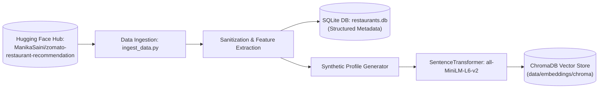

# AI-Powered Restaurant Recommendation System (Zomato Use Case)

An intelligent, production-ready restaurant recommendation system combining deterministic tabular filtering (SQLite), dense vector semantic search (ChromaDB), and Large Language Model (LLM) reasoning over the real-world **Hugging Face Zomato Restaurant Dataset** ([ManikaSaini/zomato-restaurant-recommendation](https://huggingface.co/datasets/ManikaSaini/zomato-restaurant-recommendation)).

---

## 1. System Architecture Overview

The system operates via a multi-stage funnel:
1. **Stage 1 (Deterministic Filtering)**: Evaluates hard constraints on `location`, `budget_tier` (`low`: $\le ₹500$, `medium`: $₹500-₹1500$, `high`: $> ₹1500$), numerical budget ceiling, and minimum rating. If matches $< 3$, the **Constraint Relaxation Ladder** automatically broadens criteria.
2. **Stage 2 (Semantic Similarity Match)**: Dense vector similarity computation between the user's natural language query & preferences and restaurant text profiles (`all-MiniLM-L6-v2`).
3. **Stage 3 (Hybrid Heuristic Pre-Ranking)**: Weighted scoring balancing semantic similarity (0.5), star rating (0.3), and log-scaled popularity (0.2).
4. **Stage 4 (LLM Reasoning & Synthesis)**: Context grounding prompt prompting an LLM (Gemini / OpenAI) to rank candidates, synthesize an executive **Choices Summary**, and construct personalized **"Why This Fits You"** justifications with deterministic template fallbacks.



---

## 2. Directory & Codebase Structure

```text
antigravity/
├── Docs/
│   ├── problem_statement.txt       # User problem statement & workflow
│   ├── problemStatement.md        # Comprehensive problem statement
│   ├── architecture.md            # Detailed system architecture
│   ├── implementation-plan.md     # Phase-wise roadmap
│   ├── edge-case.md               # Boundary scenarios & mitigation matrix
│   └── eval.md                    # Benchmark evaluation specification
├── data/
│   ├── raw/                       # Cached Hugging Face raw dataset
│   ├── processed/
│   │   └── restaurants.db         # SQLite metadata database (WAL mode)
│   └── embeddings/
│       └── chroma/                # ChromaDB vector collection
├── backend/
│   ├── app/
│   │   ├── main.py                # FastAPI entry point & REST routes
│   │   ├── config.py              # Configuration & Pydantic BaseSettings
│   │   ├── core/
│   │   │   ├── orchestrator.py    # Master RAG pipeline coordinator
│   │   │   └── scorer.py          # Hybrid ranking algorithm
│   │   ├── models/
│   │   │   ├── schemas.py         # Request / Response Pydantic DTOs
│   │   │   └── database.py        # SQLAlchemy SQLite models
│   │   ├── services/
│   │   │   ├── llm_service.py     # LLM reasoning, ranking & summary prompts
│   │   │   ├── vector_service.py  # ChromaDB semantic search operations
│   │   │   └── data_service.py    # SQLite filtering & relaxation logic
│   │   └── scripts/
│   │       ├── ingest_data.py     # Hugging Face dataset download & cleaning
│   │       ├── seed_sqlite.py     # Zero-dependency bootstrap seeder
│   │       └── build_index.py     # Profile embedding generator
│   ├── requirements.txt
│   └── tests/
│       ├── test_ingestion.py      # Pytest data sanitization edge-case suite
│       └── test_sanitization_standalone.py # Standalone unittest suite
├── frontend/
│   ├── index.html                 # Accessible layout & filter controls
│   ├── css/
│   │   └── style.css              # Glassmorphic dark design system
│   ├── js/
│   │   ├── app.js                 # State management & API integration
│   │   └── components.js          # Card rendering & summary presentation
│   └── assets/                    # Visual assets
├── .env.example                   # Environment configuration template
└── README.md
```

---

## 3. Phase 0 / Phase 1 Setup & Execution Guide

### Step 1: Environment Setup
Ensure Python 3.10+ is installed:
```bash
python -m venv venv
# Windows:
venv\Scripts\activate
# Linux/macOS:
source venv/bin/activate
```

Install backend dependencies:
```bash
pip install -r backend/requirements.txt
```

Copy the environment template:
```bash
cp .env.example .env
```

*(Optional: Set your `GEMINI_API_KEY` or `OPENAI_API_KEY` in `.env`. If not provided, the system automatically activates the deterministic heuristic reasoning engine).*

---

### Step 2: Data Ingestion & Sanitization

To download and sanitize the live Hugging Face dataset into `data/processed/restaurants.db`:
```bash
python backend/app/scripts/ingest_data.py
```

*Note: If offline or without Hugging Face connectivity, the script automatically activates the built-in verified seed catalog.*

To bootstrap the SQLite database immediately without third-party dependencies:
```bash
python backend/app/scripts/seed_sqlite.py
```

---

### Step 3: Run Unit Tests

Execute the unit test suite covering edge cases `DATA-01` through `DATA-07`:
```bash
pytest backend/tests/test_ingestion.py
```
Or run the zero-dependency test suite:
```bash
python -m unittest backend/tests/test_sanitization_standalone.py
```

---

### Step 4: Start the FastAPI Backend Server

Run the development server:
```bash
uvicorn backend.app.main:app --reload --host 0.0.0.0 --port 8000
```
Interactive Swagger documentation is available at:
👉 **`http://localhost:8000/docs`**

---

### Step 5: Launch the Frontend Interface

Serve the frontend directory with any static HTTP server:
```bash
cd frontend
python -m http.server 3000
```
Open **`http://localhost:3000`** in your browser.
